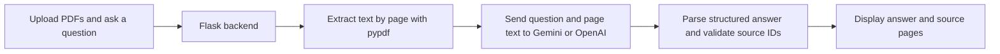

# ContextForge

A PDF question-answering assistant built with Python, Flask, and Gemini / OpenAI APIs. Upload documents, ask a question, and receive an AI-generated answer with source filenames and page references.

The current version is a local learning project with a Chinese-language web interface. It extracts text from PDFs and sends the document text with each question to the selected model.

## Features

- Upload up to five text-based PDFs through a browser interface.
- Ask questions about document content, research methods, and findings.
- Switch between Gemini and OpenAI through environment configuration.
- Display source filenames and PDF page numbers alongside answers.
- Validate that model-returned source IDs correspond to supplied pages.
- Show errors for invalid PDFs, missing API keys, provider failures, and upload limits.
- Keep API keys on the Python backend.

## How it works



This version passes the extracted document text directly to the model. Vector search, embeddings, agent tool routing, and an independent answer validator are planned extensions, not current features. Source ID validation checks that a cited page exists; it does not prove that the page supports every claim.

## Tech stack

| Component | Technology |
| --- | --- |
| Frontend | HTML, CSS, JavaScript |
| Backend | Python, Flask |
| PDF text extraction | pypdf |
| AI providers | Gemini and OpenAI |
| API client | OpenAI Python SDK; Gemini uses Google's OpenAI-compatible endpoint |
| Configuration | python-dotenv |

## Run locally

The current implementation has been tested locally with Python 3.9.6 on macOS. Install dependencies in a virtual environment. A provider API key with access to the configured model is required for AI answers.

### 1. Download the repository

Clone this repository using its GitHub **Code** button, or download and extract its ZIP. Open a terminal in the project directory.

### 2. Create an environment and install dependencies

On macOS or Linux:

```bash
python3 -m venv .venv
source .venv/bin/activate
python -m pip install -r requirements.txt
```

### 3. Configure your provider

Create your local configuration file on first setup:

```bash
cp .env.example .env
```

If you already have a `.env`, edit it instead of replacing it.

For Gemini, set:

```dotenv
AI_PROVIDER=gemini
GEMINI_API_KEY=your_gemini_api_key
GEMINI_MODEL=gemini-3.8-flash
```

For OpenAI, set:

```dotenv
AI_PROVIDER=openai
OPENAI_API_KEY=your_openai_api_key
OPENAI_MODEL=gpt-4.1-mini
```

These model IDs reflect the current application defaults. Choose a model available to your API account that supports the required API and structured output. Model access, quotas, and charges depend on your provider account; creating a key does not guarantee free usage.

Keep `.env` private. Commit `.env.example` with placeholders only. Existing terminal environment variables take precedence over `.env` values. Restart the backend after changing configuration.

### 4. Start the app

```bash
python app.py
```

Open **http://127.0.0.1:8000** in your browser. Use this URL rather than opening `index.html` directly or through Live Server. Keep the terminal running; press **Ctrl+C** to stop.

### 5. Ask a question

Upload a text-based PDF, then try:

- “What is the main research question in this paper?”
- “Summarize the methods and main findings.”
- “What limitations do the authors mention?”

## Project structure

```text
.
├── app.py              # Flask routes, PDF extraction, model calls, source validation
├── index.html          # Browser interface, styling, and request handling
├── requirements.txt    # Python dependencies
├── .env.example        # Configuration template without credentials
├── .gitignore          # Excludes secrets and local environment files
└── README.md
```

## API endpoints

| Method | Endpoint | Purpose |
| --- | --- | --- |
| GET | `/` | Serve the browser interface |
| GET | `/api/health` | Report service status, selected provider, and whether a key is configured |
| POST | `/api/ask` | Answer a question about uploaded PDFs |

`POST /api/ask` accepts multipart form fields: one `question` string and one or more `files` entries.

Example response shape (illustrative, not an actual model result):

```json
{
  "answer": "The paper identifies charging access as a relevant factor.",
  "sources": [
    {"filename": "paper.pdf", "page": 12}
  ]
}
```

The health endpoint checks configuration presence, not key validity, available credit, or model access.

## Current limits

| Limit | Value |
| --- | --- |
| Files per question | 1–5 PDFs |
| Individual file size | 20 MiB |
| Total request size | 45 MiB, including multipart overhead |
| Pages per file | 200 |
| Total extracted text | 80,000 characters |
| Question length | 1–8,000 characters |

- Scanned PDFs without an embedded text layer require OCR, which is not implemented.
- PDF extraction may lose table structure, equations, or multi-column reading order.
- References use physical PDF page numbers, which may differ from printed page labels.
- Each question is processed independently; previous messages are not sent to the model.
- AI answers and source selections can be incorrect and should be checked against the original documents.
- The server does not intentionally retain uploaded PDFs or build a persistent document library. Extracted text is sent to the selected AI provider when a question is submitted.
- The Flask development server is intended for local use. Authentication and production deployment configuration are not included.

## Troubleshooting

- **“Please start the Python backend”**: start `app.py`, open `http://127.0.0.1:8000`, and refresh the page.
- **Missing or invalid API key**: check the selected provider and its corresponding key in `.env`, then restart.
- **Quota or rate-limit error**: check the API account's balance, quota, and request limits.
- **Address already in use**: stop the previous app process before starting another on port 8000.
- **No extractable text**: use a PDF with selectable text, or apply OCR separately.

## Roadmap

- [ ] Add chunking, embeddings, and semantic retrieval for larger document collections.
- [ ] Support CSV analysis with pandas.
- [ ] Add an independent answer-grounding check.
- [ ] Support scanned documents through OCR.
- [ ] Add provider integration tests and retrieval quality evaluations.

## Provider documentation

- [Gemini API compatibility documentation](https://ai.google.dev/gemini-api/docs/openai)
- [Get a Gemini API key](https://aistudio.google.com/apikey)
- [OpenAI Python SDK documentation](https://developers.openai.com/api/docs/libraries)
- [Manage OpenAI API keys](https://platform.openai.com/api-keys)
